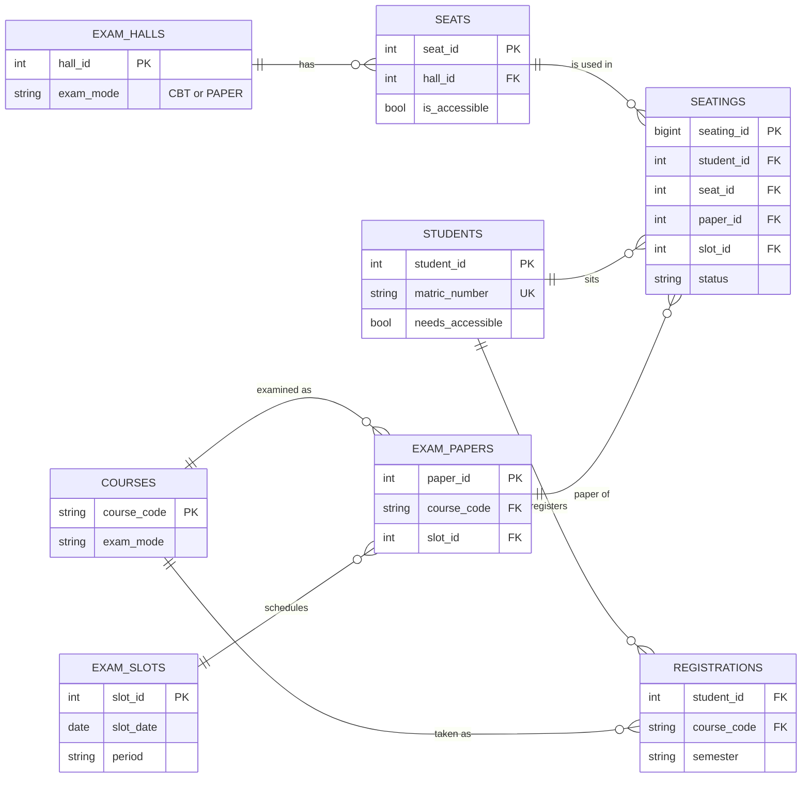

# Portfolio 1 - Database design and modelling

Case study: Miva Exam Seat Allocation (see the main README).

## ER diagram

## Design decisions
- **3NF:** halls, seats, courses, students, slots and papers each hold facts about one thing; registrations
  (student x course x semester) and seatings (student x seat x paper) are the many-to-many link tables.
- **Deliberate redundancy:** `seatings.slot_id` repeats the slot of its paper. A composite FK
  `(paper_id, slot_id) -> exam_papers` keeps it consistent, and it lets two partial UNIQUE indexes enforce
  "one seat per student per slot" and "one student per seat per slot" directly.
- **Triggers** (`schema/02_triggers.sql`) cover rules that span tables: mode match, registration, accessible seat.
  The partial UNIQUE indexes are the real guarantee against double booking; the triggers give clear messages.
- **Data:** 5 halls (860 seats), 36 courses, 1,200 students, 9 semesters (8 past + the current one whose 12 slots
  start tomorrow), 64,800 registrations and 64,800 seatings. Past seatings are SAT or ABSENT (about 3%),
  upcoming ones are ASSIGNED. The bulk load switches the triggers off for speed and then audits the same rules
  with SQL (all three audits must show 0 violations).
- **Tests** (`tests/05_constraint_tests.sql`): each test builds its situation from live data, tries one bad
  statement and checks it fails for the intended reason; T8 is a control that must succeed. Everything is rolled back.

Run: `bash run_p1.sh 2>&1 | tee p1_output.log`
