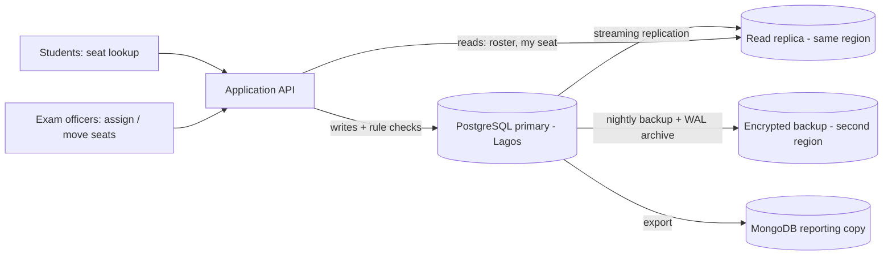

# Cloud architecture - Miva exam seat allocation

## Workload
Exam periods are very spiky: about 1,200 students (growing) look up their seat in the same hour, while writes
(assigning or moving a seat) are rare and come from a handful of exam officers. Reads dominate (roughly 50:1).

## Design (diagram)

## Choices and why
| Decision | Choice | Reason |
|---|---|---|
| System of record | PostgreSQL primary | the rules (mode match, registration, accessible seat, one seat per slot) are enforced by the database |
| Read scaling | streaming read replica (built in P5) | seat look-ups and printed rosters never compete with seat assignment |
| Partitioning | one partition per semester | old semesters can be archived with DETACH instead of a slow DELETE |
| Reporting | MongoDB copy (P4) | attendance dashboards without joins |
| Availability | backups in a second region, tested restore | a lost database on exam day is the worst case |
| Consistency | replica is asynchronous | a seat seen a fraction of a second late is fine; the primary decides conflicts |

## Trade-offs to defend
- An asynchronous replica can lag; anything that must be exactly current (assigning a seat) goes to the primary.
- Keeping the primary in Nigeria is a design choice (low latency, simpler compliance story), not a legal requirement.
- Two database engines cost more to run; MongoDB is only a rebuildable copy, never the source of truth.
